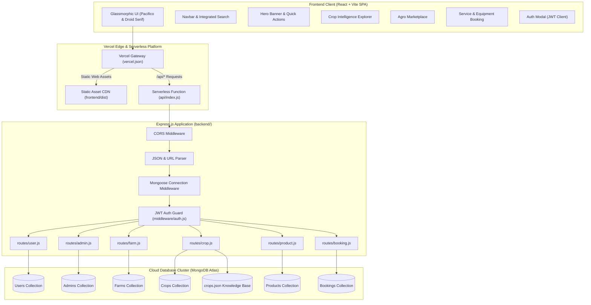
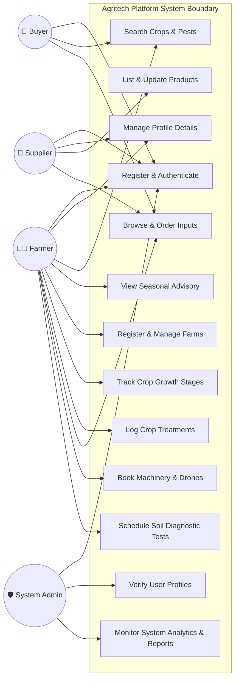
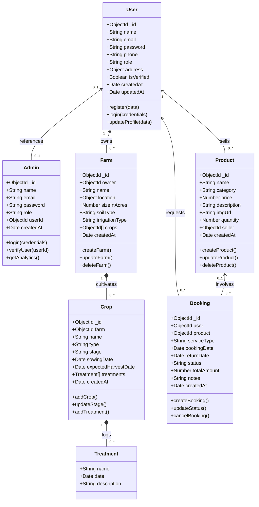
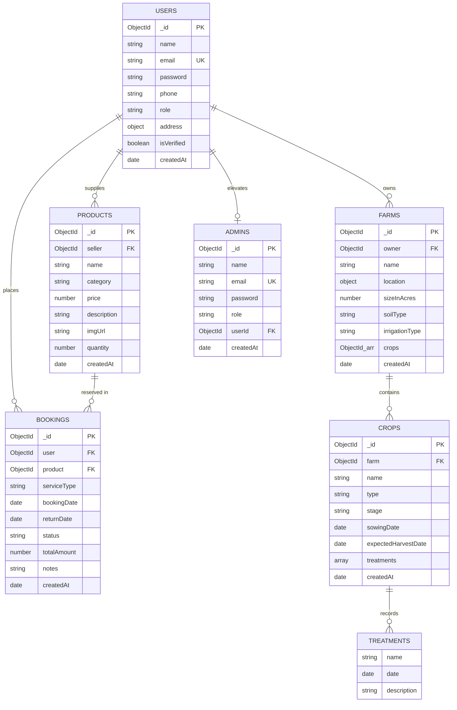
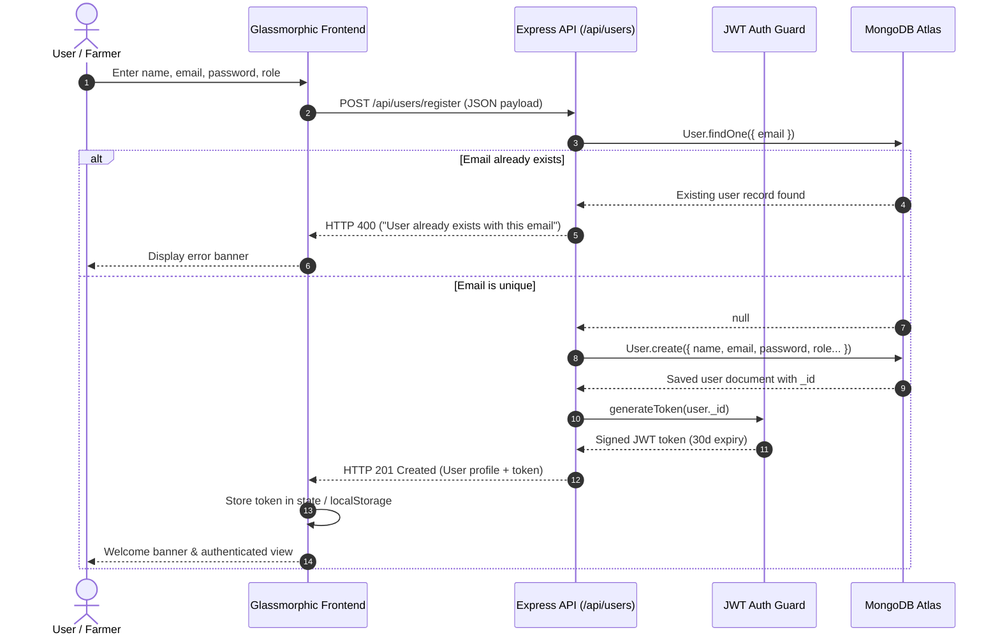
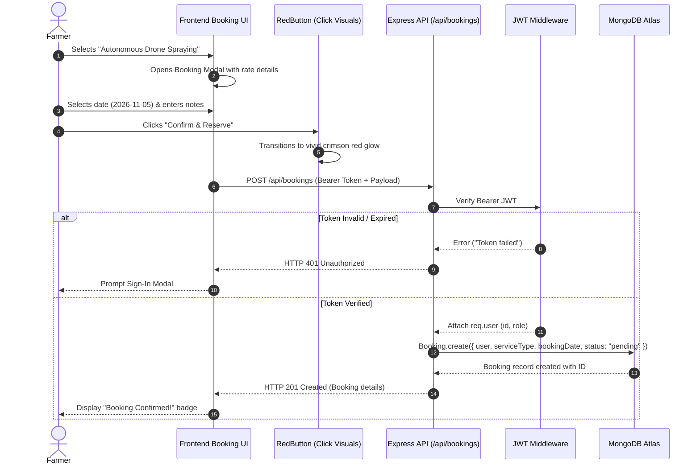
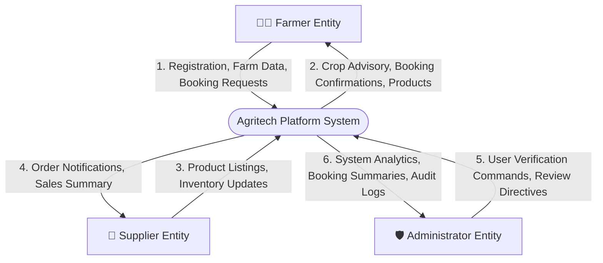
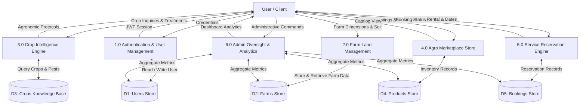
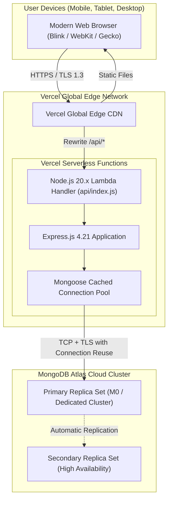

# UML & System Architecture Diagrams
## Agritech — Precision Agriculture Platform

This document presents the complete architectural, structural, and behavioral UML diagrams for the **Agritech** ecosystem. All diagrams are authored using standard **Mermaid** syntax for dynamic visualization directly inside GitHub and Markdown viewers.

---

## Table of Contents
1. [System Architecture Diagram](#1-system-architecture-diagram)
2. [Use Case Diagram](#2-use-case-diagram)
3. [Class Diagram](#3-class-diagram)
4. [Entity-Relationship (ER) Diagram](#4-entity-relationship-er-diagram)
5. [Sequence Diagrams](#5-sequence-diagrams)
   - [5.1 User Authentication Flow](#51-user-authentication-flow)
   - [5.2 Service & Equipment Booking Flow](#52-service--equipment-booking-flow)
6. [Data Flow Diagrams (DFD)](#6-data-flow-diagrams-dfd)
   - [6.1 DFD Level 0 (Context Diagram)](#61-dfd-level-0-context-diagram)
   - [6.2 DFD Level 1 (Decomposition Diagram)](#62-dfd-level-1-decomposition-diagram)
7. [Component Deployment Diagram](#7-component-deployment-diagram)

---

## 1. System Architecture Diagram

High-level client-serverless architecture running on Vercel with MongoDB Atlas.

---

## 2. Use Case Diagram

Identifies platform actors (Farmer, Supplier, Buyer, Admin) and their operational use cases.

---

## 3. Class Diagram

Object Data Model representing Mongoose schemas, attributes, datatypes, and associations.

---

## 4. Entity-Relationship (ER) Diagram

Relational model mapped into MongoDB document collections with foreign key references.

---

## 5. Sequence Diagrams

### 5.1 User Authentication Flow

Illustrates registration, duplicate validation, and JWT generation.

### 5.2 Service & Equipment Booking Flow

Illustrates reservation of tractors, drones, or soil diagnostic services.

---

## 6. Data Flow Diagrams (DFD)

### 6.1 DFD Level 0 (Context Diagram)

High-level boundary representation of inputs, outputs, and external entities.

### 6.2 DFD Level 1 (Decomposition Diagram)

Subsystem processing and bidirectional data store interaction.

---

## 7. Component Deployment Diagram

Physical deployment mapping onto Vercel global infrastructure and MongoDB Atlas.

